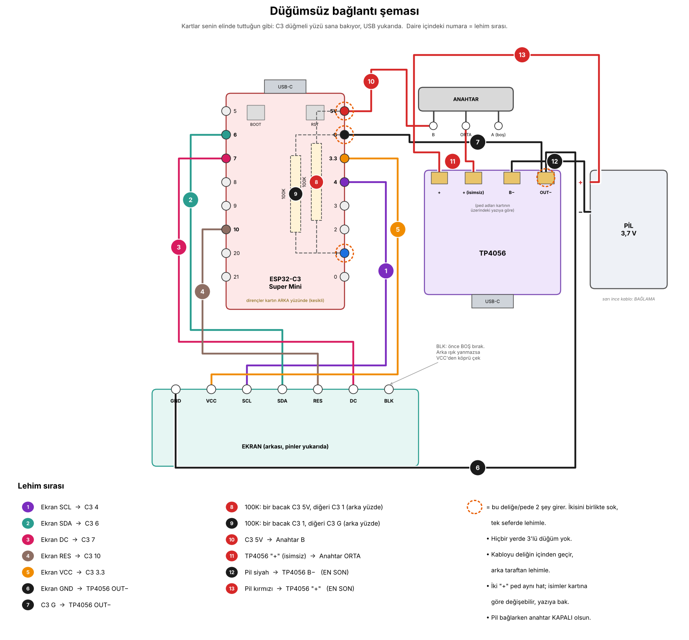
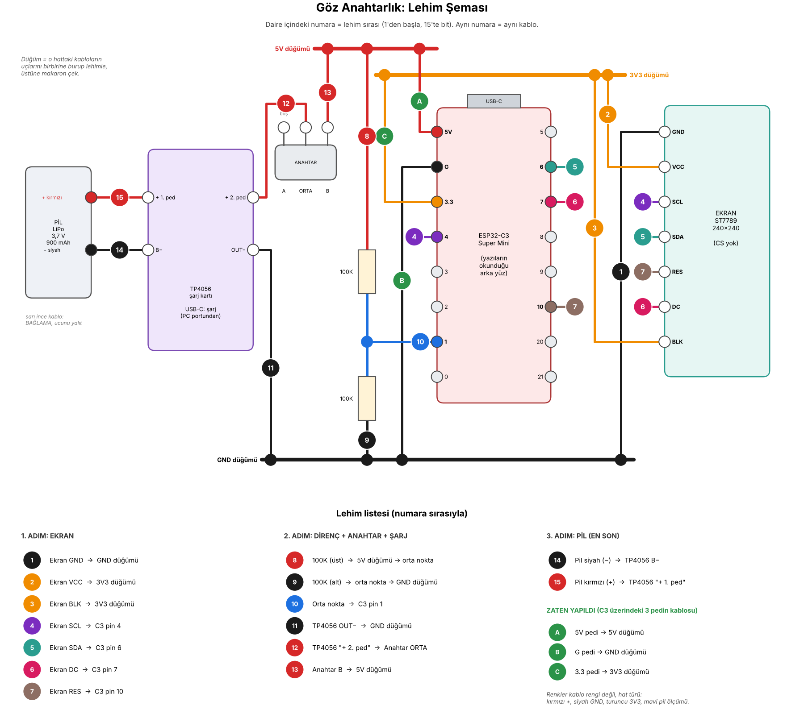
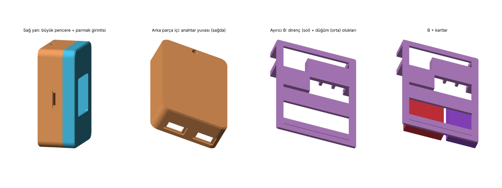

# Göz — animasyonlu robot gözlü anahtarlık

**Eyes Keychain:** a pocket-sized animated robot-eyes keychain (ESP32-C3 + 1.3" ST7789 screen) controlled from an Android app over Bluetooth LE.

Küçük bir ekranda yaşayan gözler: göz kırpar, etrafa bakar, duygu gösterir. Telefondaki uygulamayla modlarını değiştirir, çalan şarkının adını, sözlerini ve albüm kapağını gösterir, ritme göre kafa sallar.

## Neler yapıyor

- **Gözler:** 8 mod (Normal, Relax, Hareketli, Üzgün, Odak, Rock, Saat, Özel), 15 boşta hareketi, 8 duygu, yaylı (spring) animasyon.
- **Müzik:** çalan şarkının adı, zamanlı sözler (LRCLIB), albüm kapağı (tam ekran seçeneğiyle), ritme göre kafa sallama (Deezer BPM + elle ritim).
- **Telefon bağlantısı:** bildirim gelince şaşırır, pomodoro sayacı, saat ve hava durumu.
- **Göz tasarlayıcı:** kaydırıcılarla kendi gözünü tasarla, anahtarlığa "Özel" mod olarak gönder.
- **Pil ve ışık:** pil yüzdesi, şarj algılama, parlaklık, otomatik kararma, gece uykusu.
- **Kablosuz yazılım güncelleme:** uygulamadan `.bin` seçip Bluetooth ile güncelle.
- Başka alfabelerdeki şarkı adları (Japonca, Rusça…) Latin harflere çevrilip gösterilir.

## Klasörler

| Klasör | İçerik |
|---|---|
| `firmware/` | Anahtarlık yazılımı (`eyes_keychain.ino`, tek dosya) ve Türkçe yazı tipi üreticisi |
| `app/EyesKeychainApp/` | Android uygulaması (Kotlin + Jetpack Compose) |
| `case/` | 3D baskı kasa: STL dosyaları, Python modeli, kablolama şemaları |
| `sim/` | Yazılımı bilgisayarda çalıştıran simülasyon ve testler |
| `build_apk.sh` | APK'yı sıfırdan derleyen betik |
| `DEVAM.md` | Ayrıntılı proje notu: pinler, Bluetooth komut tablosu, yapılan hatalar |

## Donanım

ESP32-C3 Super Mini, 1.3" 240×240 ST7789 ekran (CS pini yok), 900 mAh LiPo, TP4056 Type-C şarj kartı, kaydırmalı anahtar, pil ölçümü için 2×100K direnç bölücü.

Pinler: SCL=4, SDA=6, DC=7, RES=10, BLK=3 (PWM), pil ölçümü=GPIO1, düğme=GPIO9 (BOOT).

| Düğümsüz bağlantı şeması | Lehim şeması (v3, lehim sırasıyla) |
|---|---|
|  |  |

> Lehim şemasında ekran BLK'si 3V3'e bağlı çizilmiş (parlaklık ayarı yok). Parlaklık, otomatik kararma ve gece uykusu için BLK'yi **GPIO 3**'e taşı.



## Anahtarlık yazılımını yükleme

1. Arduino IDE'ye ESP32 kart paketini kur; kütüphaneler: **LovyanGFX**, **NimBLE-Arduino 2.x**.
2. Kart: ESP32C3 Dev Module. **Partition Scheme: Default 4MB with spiffs** (kablosuz güncelleme için şart), **USB CDC On Boot: Enabled**.
3. `firmware/eyes_keychain/eyes_keychain.ino` dosyasını aç ve yükle.
4. Sonraki güncellemeler kablosuz: Sketch → Export Compiled Binary → `eyes_keychain.ino.bin` dosyasını uygulamada Araçlar → Dosya seç → Güncelle ile gönder (içinde "merged" geçen dosyayı değil).

## Uygulamayı derleme

```bash
bash build_apk.sh        # Java, Gradle ve Android SDK'yı kendisi kurar; çıktı: Goz.apk
```

Ya da klasörü Android Studio'da aç (`app/EyesKeychainApp`). İnternet gerekir (dl.google.com, Maven, Gradle).

APK varsayılan olarak Android'in debug anahtarıyla imzalanır. Kendi sabit anahtarını kullanmak istersen `app/EyesKeychainApp/app/goz.keystore` koy ve `GOZ_KEYSTORE_PASSWORD` ortam değişkenini ayarla (anahtar repoya konmaz, `.gitignore`'da).

Uygulama ilk açılışta Bluetooth izni ister; müzik takibi ve bildirimler için **Bildirim erişimi** ayrıca açılmalıdır.

## Dış servisler

Anahtarsız, ücretsiz: [LRCLIB](https://lrclib.net) (sözler), [Deezer](https://developers.deezer.com/api) (BPM), [Open-Meteo](https://open-meteo.com) (hava durumu).

## Lisans

[MIT](LICENSE): kodu, kasayı ve şemaları özgürce kullanabilir, değiştirebilir ve paylaşabilirsin; telif notunu korumak yeterli.
